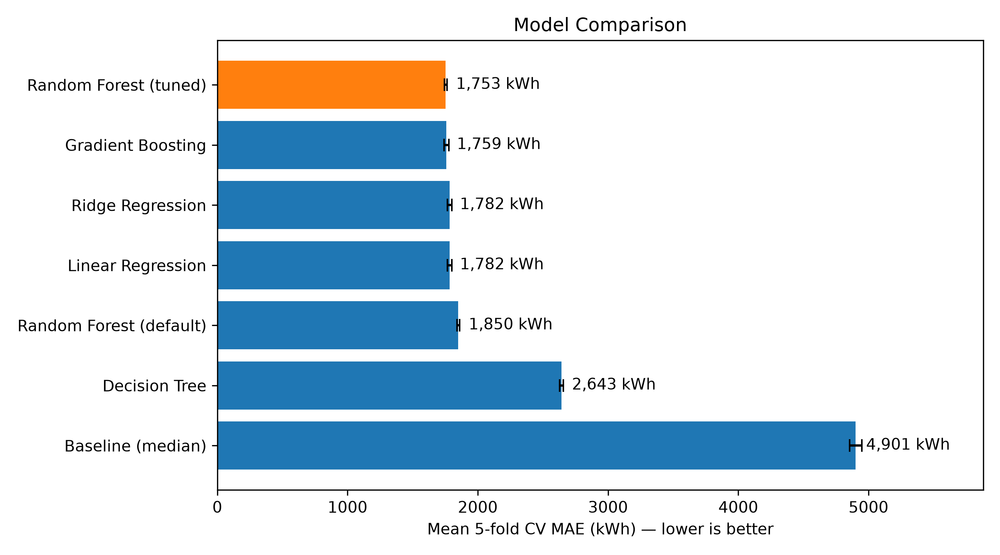
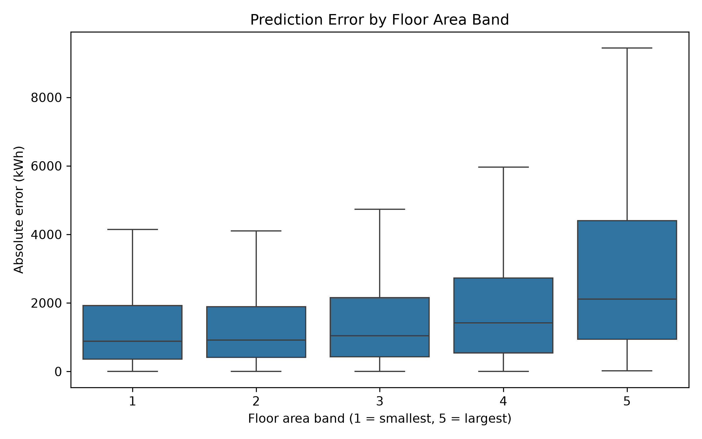
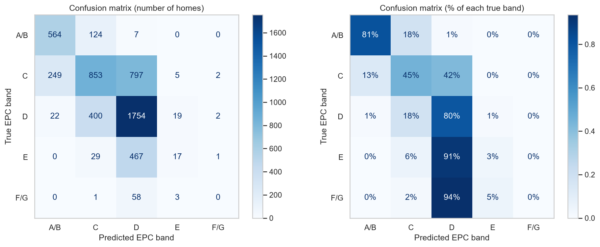

# Predicting Home Energy Use and EPC Bands from the UK NEED Dataset

**Team:** Fawad Saleem, Hetashri Kalyani, Daria Basha, Luis Wulf (Group 4)
**Course:** AI Methods I – Day 2: Supervised learning (IAAC MaAI 2026/27)

**Models on Hugging Face:**
- **Gas consumption (regression):** https://huggingface.co/iaac-maai/Day2-team4-residential-gas-consumption-predictor
- **EPC band (classification):** https://huggingface.co/iaac-maai/Day2-Team4-epc-band-predictor

This repository trains and evaluates two supervised models on the same cleaned Day 1 dataset:

1. **Gas consumption model:** predicts how much gas a home will use in 2024 (kWh).
2. **EPC band model:** predicts a home's EPC band (A/B, C, D, E, F/G) from its gas and electricity use and its building characteristics.

**Both models are part of our submission.** Each one has its own complete model card on Hugging Face.

## Use case

**Gas consumption model.** An energy supplier or a local energy-planning team wants to estimate next year's gas demand of individual homes, from the building's characteristics and its last three years of consumption. The costly mistake is **under-estimating the large consumers**: they drive the total demand and the biggest bills. We use **MAE** as the main metric, because it is easy to read in kWh, and we also report **RMSE**, which punishes the large errors.

**EPC band model.** A council or retrofit programme wants a **first, rough estimate** of the energy rating of homes that have no EPC, from their meter readings and basic building data. The costly mistake is **missing an inefficient home** (E or F/G), because it would not be offered help. The classes are very imbalanced, so we use **macro F1** as the main metric: it gives every band the same weight.

## Dataset

| | |
|---|---|
| **Name** | National Energy Efficiency Data-Framework (NEED), anonymised 50k sample |
| **Source** | [UK Department for Energy Security and Net Zero](https://www.gov.uk/government/collections/national-energy-efficiency-data-framework-need) |
| **One row is** | one home in England or Wales |
| **Rows** | 49,998 after cleaning (Day 1), 96 columns |
| **Rows used** | Gas model: 39,502 homes with a 2024 gas reading. EPC model: 26,866 of them that also have a known EPC band |
| **Licence** | [Open Government Licence v3.0](https://www.nationalarchives.gov.uk/doc/open-government-licence/version/3/) |

The cleaning is documented in our Day 1 repository: https://github.com/iaac-maai/Group4-day1-assignment

## Repository structure

```
├── data/
│   └── .gitkeep                           # the cleaned dataset goes here (not committed, see How to run)
├── figures/                               # exported plots (shown below)
├── models/
│   ├── README.md                          # index of the two model cards
│   ├── gas_consumption/README.md          # model card: gas consumption model
│   └── epc_band/README.md                 # model card: EPC band model
├── notebook/
│   ├── 01_data_preparation.ipynb          # first look at the cleaned data
│   ├── 02_model_training.ipynb            # gas consumption model (regression)
│   └── 03_epc_band_prediction.ipynb       # EPC band model (classification)
├── README_03_epc_band_prediction.md       # detailed write-up of the EPC model
├── .gitignore
├── LICENSE
├── README.md
└── requirements.txt
```

The trained models (`.joblib` files) are **not** on GitHub. Running the notebooks saves them to `models/`, and the published versions are on Hugging Face (links above).

## How to run

```bash
python -m venv .venv
.venv\Scripts\activate           # macOS / Linux: source .venv/bin/activate
pip install -r requirements.txt
```

1. **Get the cleaned dataset** (18 MB, so it is not committed):
   - Download the NEED anonymised 50k sample (`anon2026_50k.csv`) from the [NEED page](https://www.gov.uk/government/collections/national-energy-efficiency-data-framework-need).
   - Put it in `data/` of our [Day 1 repository](https://github.com/iaac-maai/Group4-day1-assignment) and run `notebook/uk_energy_consumption_eda.ipynb` there. It saves `data/anon2026_50k_cleaned.csv`.
   - Copy `anon2026_50k_cleaned.csv` into the `data/` folder of this repository.
2. Open `notebook/02_model_training.ipynb`, select the `.venv` kernel and click **Run All**. It saves `models/final_gas_consumption_model.joblib`.
3. Open `notebook/03_epc_band_prediction.ipynb` and click **Run All** (about 1–2 minutes). It saves `models/epc_band_gradient_boosting.joblib`.

## Approach

| | Gas consumption model | EPC band model |
|---|---|---|
| **Problem type** | Regression | Classification (5 ordered classes) |
| **Target** | `Gcons2024` (kWh) | `EPC` (A/B, C, D, E, F/G) |
| **Main metric** | MAE (also RMSE, R²) | Macro F1 (also accuracy) |
| **Inputs** | `PROP_TYPE`, `PROP_AGE_BAND`, `FLOOR_AREA_BAND`, `COUNCIL_TAX_BAND`, `REGION`, `MAIN_HEAT_FUEL`, `Gcons2023`, `Gcons2022`, `Gcons2021` | `Gcons2024`, `Econs2024`, `FLOOR_AREA_BAND`, `PROP_AGE_BAND`, `LI_FLAG`, `CWI_FLAG`, `PV_FLAG`, `PROP_TYPE`, `REGION` |
| **Removed inputs** | `GasValFlag2024` (it is only known together with the target: leakage) | `MAIN_HEAT_FUEL` (the same value for every home in the subset); homes with `No EPC` set aside |
| **Preprocessing** | Numbers: median imputation + scaling. Categories: most-frequent imputation + one-hot encoding | Numbers and ordered bands: median imputation (+ scaling for linear models and KNN). Categories: most-frequent imputation + one-hot encoding |
| **Split** | 80/20, `random_state=42` | 80/20, stratified by EPC band, `random_state=42` |
| **Models compared** | Baseline (median), Linear Regression, Ridge, Decision Tree, Random Forest, Histogram Gradient Boosting | Baseline (most frequent), Logistic Regression, KNN, Decision Tree, Random Forest, Histogram Gradient Boosting |
| **Tuning** | `GridSearchCV` on Random Forest and Gradient Boosting | `GridSearchCV` on Gradient Boosting (incl. `class_weight`) |
| **Final model** | Random Forest (`max_depth=10`, `n_estimators=100`) | Histogram Gradient Boosting (`learning_rate=0.1`, `max_leaf_nodes=31`) |

All preprocessing is inside a scikit-learn `Pipeline`, so nothing leaks between the cross-validation folds.

## Results

### Gas consumption model

5-fold cross-validation on the training set (MAE in kWh, lower is better):

| Model | CV MAE (mean ± std) |
|---|---:|
| Baseline (median) | 4,901 ± 48 |
| Decision Tree | 2,643 ± 14 |
| Random Forest (default) | 1,850 ± 10 |
| Linear Regression | 1,782 ± 17 |
| Ridge Regression | 1,782 ± 17 |
| Gradient Boosting | 1,759 ± 18 |
| **Random Forest (tuned)** | **1,753 ± 11** |



**Test set:** MAE 1,777 kWh · RMSE 3,129 kWh · R² 0.78


`Gcons2023` alone gets 90% of the feature importance. On the test homes with a 2023 reading, simply predicting "2024 = 2023" has a **lower MAE** (1,685 vs 1,731 kWh), while the Random Forest has a **lower RMSE** (3,013 vs 3,118 kWh): it makes fewer very large errors.



### EPC band model

Stratified 5-fold cross-validation on the training set:

| Model | Macro F1 (mean ± std) | Accuracy |
|---|---:|---:|
| Baseline (most frequent) | 0.116 ± 0.000 | 0.409 |
| KNN (k=25) | 0.381 ± 0.003 | 0.577 |
| Random Forest | 0.387 ± 0.004 | 0.594 |
| Decision Tree | 0.390 ± 0.006 | 0.594 |
| Logistic Regression | 0.395 ± 0.002 | 0.602 |
| **Gradient Boosting** | **0.397 ± 0.008** | **0.599** |

**Test set:** macro F1 0.40 · accuracy 59% · 98% of homes within ±1 band



A/B and D are recognised well (recall 81% and 80%), but E and F/G are almost always predicted as D. More details and figures: [README_03_epc_band_prediction.md](README_03_epc_band_prediction.md).

## Limitations

- **Gas model:** last year's consumption dominates the model. A simple "same as last year" rule is as good on MAE, so the model adds little for an average home. Errors grow for large, high-consumption homes.
- **Gas model:** the test set was also used for the previous-year comparison, so it is not a completely untouched benchmark.
- **EPC model:** it rarely predicts the inefficient bands (E, F/G), so it is **not suitable for finding inefficient homes**, which is exactly the costly mistake of our use case. Its estimates for homes without an EPC are a rough indication only, never a replacement for a real EPC assessment.
- Consumption also depends on occupants, heating habits and weather, which are not in the data.
- Feature importance shows what the models rely on, not causes.
- The data covers England and Wales only. Results may differ for other regions or years.

## AI usage disclosure

| | |
|---|---|
| **Tools** | Claude (Anthropic), in chat and as an agent that read the course repository, wrote and tested code and edited files in our project folder. ChatGPT (chat). |
| **Why** | To understand the supervised learning workflow from class, to structure our two notebooks, to debug code and Git problems, and to write the documentation. |
| **Where** | Model comparison and error plots in `02_model_training.ipynb`, the structure of `03_epc_band_prediction.ipynb`, the Git/GitHub workflow (fork, pull request), this README and the two model cards. |
| **How** | We first tried to write the code ourselves, then asked the AI to explain errors and to suggest improvements. Example prompt: *"Check our Day 2 repository against the submission checklist. What is missing?"* The answer pointed out missing Hugging Face links, model-card sections and that our test set was also used for a baseline comparison; we fixed the first two and kept the third as a stated limitation. **How we checked:** we re-ran the notebooks (**Restart → Run All**) and compared every number in the README and model cards with the notebook outputs. **What we decided ourselves:** we chose the unweighted EPC model ourselves, even though the grid search ranked the balanced one higher (see the EPC write-up). |

**Lessons learned:** The AI was most useful for explaining *why* something works, for example why macro F1 is better than accuracy for imbalanced classes, and for checking our work against the assignment checklist. It works much better when it knows our exact data and the assignment brief; with only a short question, its answers were more general. Next time we would give it the column list and the assignment brief from the start, and agree in the team who uses which tool, so that the disclosure is easier to write.

We are responsible for every modelling decision and every number in this repository.

## Licence

The code in this repository is released under the [MIT License](LICENSE). The two models on Hugging Face are also released under the MIT License.

The data is **not** covered by the MIT License. It is the NEED anonymised dataset, UK Department for Energy Security and Net Zero, published under the [Open Government Licence v3.0](https://www.nationalarchives.gov.uk/doc/open-government-licence/version/3/). Contains public sector information licensed under the Open Government Licence v3.0.
