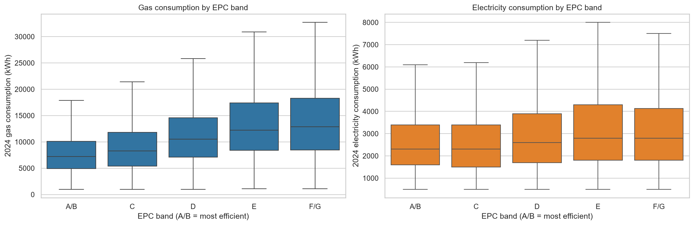
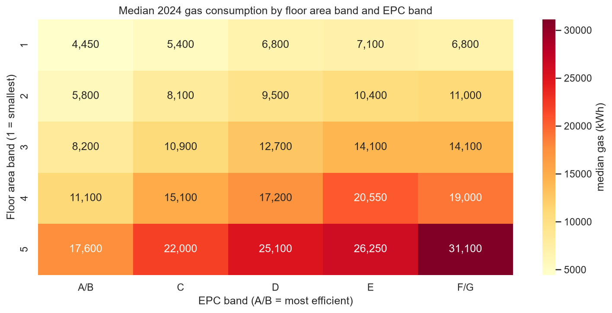
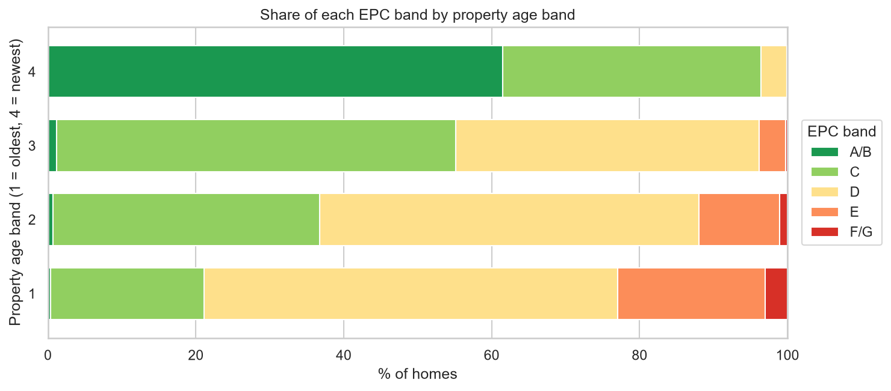
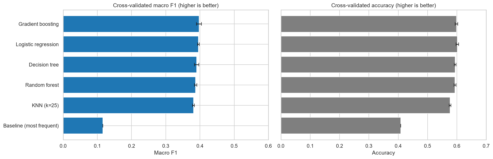
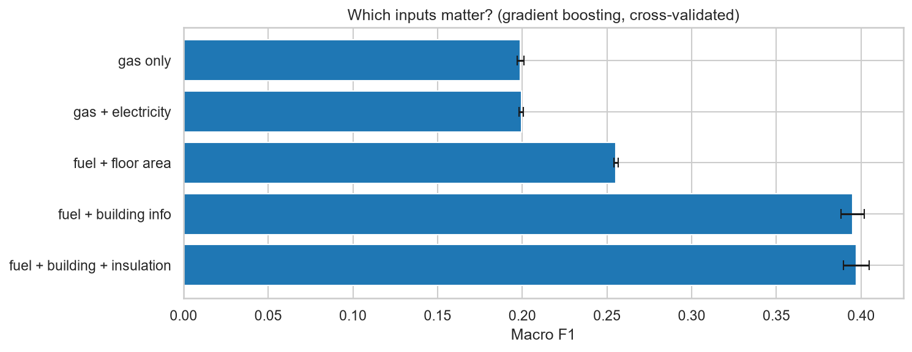
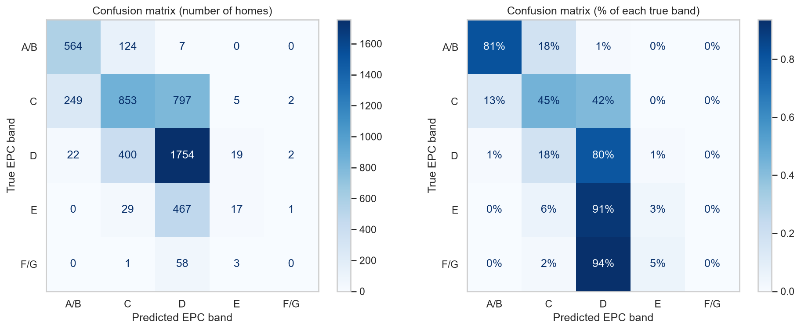
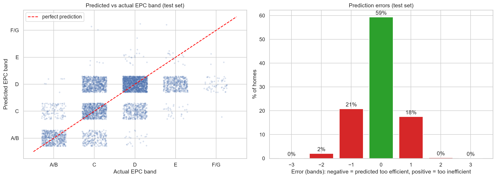
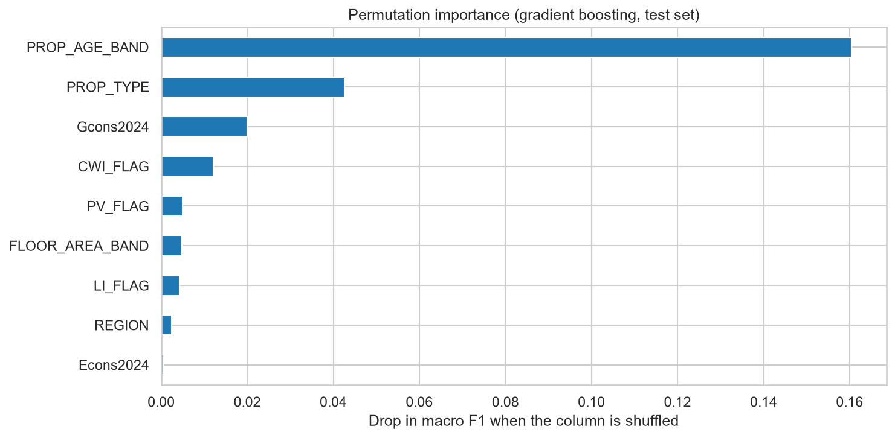
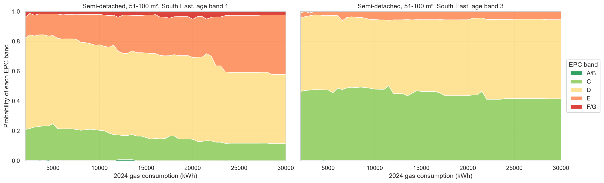

# Energy Rating (EPC Band) Prediction from Gas and Electricity Consumption

**Notebook:** `notebooks/03_epc_band_prediction.ipynb`  
**Task:** Classification: *Given its gas and electricity use, what is this home's EPC band?*

## Objective

Predict the **EPC band** of a home from its annual **gas and electricity consumption**, helped by building characteristics: *"If this is the fuel consumption, what is the energy rating?"*

## Features and target

* **Target:** `EPC`, with 5 ordered classes: A/B (most efficient), C, D, E, F/G (least efficient)
* **Fuel consumption:** `Gcons2024`, `Econs2024`
* **Building characteristics:** `FLOOR_AREA_BAND`, `PROP_AGE_BAND`, `PROP_TYPE`, `REGION`
* **Efficiency measures:** `LI_FLAG`, `CWI_FLAG`, `PV_FLAG`

Homes marked **"No EPC"** (12,636) are excluded from training. At the end, the finished model is used to estimate their rating. That leaves **26,866 homes**, split 80/20 and stratified by EPC band (21,492 train / 5,374 test).

`MAIN_HEAT_FUEL` is excluded because every home in this subset has the same value (mains gas).

## Methodology

1. **Exploration:**
   * fuel consumption by EPC band
   * median gas use by floor area band x EPC band
   * EPC share by property age
2. **Preprocessing:**
   * Numerical features: median imputation and standardisation (standardisation for linear models and KNN only).
   * Categorical features: most-frequent imputation and one-hot encoding.
3. **Model comparison:** stratified five-fold cross-validation, with **macro F1** as the main metric. Accuracy is also reported.
4. **Input experiment:** the same model is trained on growing sets of inputs, to measure how much fuel consumption alone can tell.
5. **Class imbalance:** an experiment with `class_weight="balanced"`.
6. **Hyperparameter tuning:** `GridSearchCV` on Histogram Gradient Boosting (learning rate, number of leaves, class weight).

The classes are imbalanced: C and D make up 76% of homes, while F/G is only 1.2%. Macro F1 gives each EPC band equal weight, so the rare bands count as much as the common ones.

## Cross-validation results

| Model | Macro F1 | Accuracy |
|---|---:|---:|
| Baseline (most frequent) | 0.116 | 0.409 |
| KNN (k=25) | 0.381 | 0.577 |
| Random Forest | 0.387 | 0.594 |
| Decision Tree | 0.390 | 0.594 |
| Logistic Regression | 0.395 | 0.602 |
| **Gradient Boosting** | **0.397** | **0.599** |

## Which inputs matter?

| Inputs | Macro F1 |
|---|---:|
| Gas only | 0.199 |
| Gas + electricity | 0.199 |
| Fuel + floor area | 0.255 |
| Fuel + building information | 0.395 |
| Fuel + building + insulation | 0.397 |

## Model selection

The grid search ranked `class_weight="balanced"` slightly higher (macro F1 0.410 vs 0.397). We still selected the **unweighted** Gradient Boosting model (`learning_rate=0.1`, `max_leaf_nodes=31`), because the balanced model:

* is much less accurate (48% vs 60% of homes in exactly the right band)
* heavily over-predicts the rarest band, F/G: only about 4% of its F/G predictions were correct

## Test results

| Metric | Result |
|---|---:|
| Accuracy (exact band) | 59% |
| Within ±1 EPC band | 98% |
| Macro F1 | 0.40 |

## Key findings

* **Gas and electricity consumption alone are a weak predictor of the EPC band.** They reach a macro F1 of 0.20, against 0.12 for the baseline, and electricity adds nothing on top of gas.
* **Gas use only becomes informative once the home's size is known.** Within the same floor area band, worse EPC bands use clearly more gas (e.g. 5,800 → 11,000 kWh for 51–100 m² homes).
* **Property age is the strongest predictor**, followed by property type and then gas consumption. 58% of the newest homes are rated A/B.
* A/B and D are recognised well (81% and 80%). **E and F/G are almost always predicted as D**, because they are rare and their consumption is similar to D homes.
* The EPC rating is calculated mainly from the building fabric, not from measured consumption. This explains why consumption says more about **how big** a home is than about **how efficient** it is.

## Dataset

The notebook uses the cleaned dataset prepared on Day 1: `data/anon2026_50k_cleaned.csv`. It contains 49,998 homes x 96 columns. Of the 39,502 homes with a 2024 gas reading, **26,866** have a known EPC band and are used for training and testing.

## Visualisations

All plots are saved in `figures/`. The file names start with `04_` because the notebook was first numbered 04.

### Fuel consumption by EPC band

Gas use rises as the rating gets worse. Electricity changes much less.



### Median gas use by floor area and EPC band

Read row by row: within the same size, worse EPC bands use more gas.



### EPC band by property age

Newer homes are mostly A/B, while older homes are mostly D or worse.



### Model comparison

All models clearly beat the baseline, and land close to each other.



### Which inputs matter?

Fuel use alone is weak. Building information doubles the score.



### Confusion matrix (test set)

A/B and D are recognised well; E and F/G are mostly predicted as D.



### Predicted vs actual EPC band (test set)

59% of homes are in exactly the right band and 98% within ±1 band.



### Permutation importance

Property age matters most, then property type, then gas consumption.



### EPC probability vs gas use

For an old home, higher gas use shifts the probabilities towards worse bands.



## Saved Model

`models/epc_band_gradient_boosting.joblib`: the full Gradient Boosting pipeline (preprocessing + model). Load it with `joblib.load()`, or use the notebook's `predict_epc()` function:

```python
predict_epc(gas_kwh=10_000, elec_kwh=2_500, floor_area_band=2,
            prop_type="Semi detached", age_band=1)
# -> EPC band D, with the probability of each band
```

Model files are ignored by `.gitignore` (`models/*.joblib`). Running the notebook recreates the file.

## How to Run

1. Clone the repository.
2. Create and activate a Python virtual environment.
3. Install the dependencies: `pip install -r requirements.txt`
4. Check that `data/anon2026_50k_cleaned.csv` is in place.
5. Open `notebooks/03_epc_band_prediction.ipynb` and run the cells in order (**Run All**). It takes about 1–2 minutes.

## Limitations

* The rare inefficient bands (E, F/G) are rarely predicted, so the model is not suitable for finding inefficient homes.
* The model leans towards band D when unsure. Its estimates for homes without an EPC (79% D) are a rough indication only, never a replacement for a real EPC assessment.
* Consumption also depends on occupants, heating habits and weather, which are not in the data.
* Feature importance describes what the model relies on. It does not establish causation.
* Results may differ on other datasets, regions or future years.

## AI Use Disclosure

AI tools were used to support aspects of coding, debugging, explanation, and documentation.

## Authors

IAAC AI Methods — Group 4
